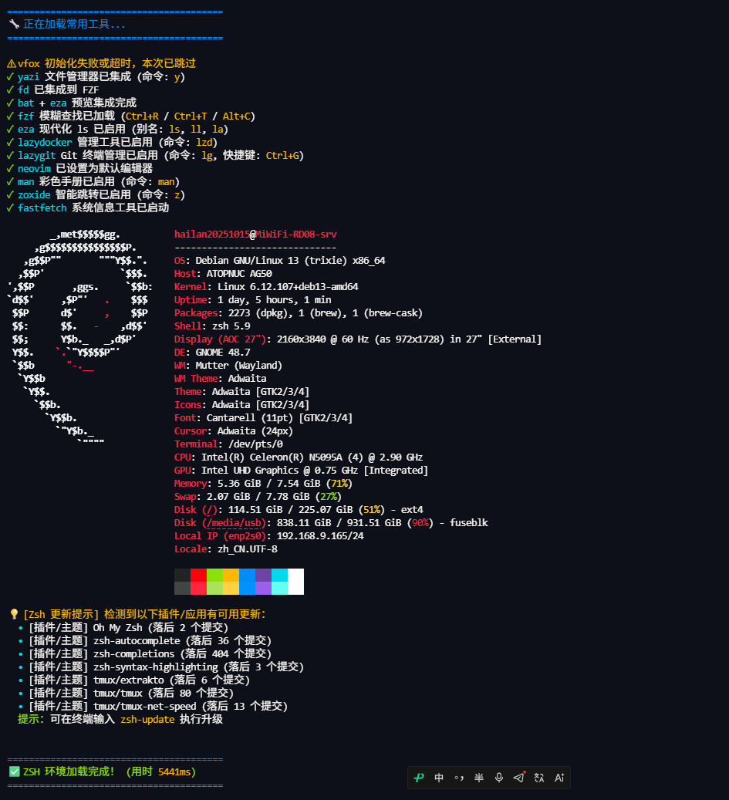

<div align="center">

# Zsh Configuration Manager

**A personalized terminal. A manageable configuration.**

Oh My Zsh · Powerlevel10k · Smart completions · Optional CLI tools

[](https://github.com/vicky-clair/xao_Rui_is-one-lick-configuration-script-for-ZSH/actions/workflows/tests.yml)


**English** · [简体中文](README.zh-CN.md) · [日本語](README.ja.md)

[Preview](#preview) · [Quick start](#quick-start) · [Everyday commands](#everyday-commands) · [Documentation](#documentation)

</div>

Set up a Zsh environment for Linux or macOS with themes, completions, autosuggestions, and syntax highlighting. Add your favorite terminal tools, adjust feature switches, check for updates, and manage configuration backups from one project.

> **Platform status:** Linux and macOS are implementation targets, not a guarantee that every package or platform combination has been tested. See [Testing & validation](INSTALLER_TESTING.md) for recorded checks.

## Preview



<p align="center"><sub>Debian GNU/Linux 13 · Zsh 5.9 · Chinese-language startup output</sub></p>

| A polished prompt | Tools within reach | Maintenance built in |
| :--- | :--- | :--- |
| Powerlevel10k with Rainbow, Lean, Classic, or the official setup wizard | FZF search, zoxide navigation, Yazi, Neovim, and optional Git/container dashboards | Feature switches, update checks, configuration backups, and disable/restore controls |

<details>
<summary><strong>About this screenshot</strong></summary>

- **Tool status:** integrations such as Yazi, FZF, television, eza, tre, lazygit, Neovim, and zoxide, with commands and shortcuts.
- **System overview:** Fastfetch displays the Debian logo, OS, kernel, desktop, and hardware information.
- **Update reminder:** a cached list of plugin updates; run `zsh-update` to enter the update flow.
- **Startup timing:** `5441ms` measures this particular configuration load. It excludes the full terminal connection process and the user extensions, highlighting, and first-prompt hooks loaded afterward.

The message `vfox 初始化失败或超时，本次已跳过` means vfox initialization failed or timed out and was skipped for that session; other tools continued loading. See [Troubleshooting](ZSH_TROUBLESHOOTING.md). Machine details, update counts, and timing are historical observations.

</details>

## Quick start

Run these commands as your normal user on the target Linux or macOS machine. Linux package installation uses `sudo` when needed; do not run `sudo bash install.sh`.

### 1. Clone and preview

```bash
git clone https://github.com/vicky-clair/xao_Rui_is-one-lick-configuration-script-for-ZSH.git "$HOME/.zsh-project"
cd "$HOME/.zsh-project"
bash scripts/test_installer.sh
bash scripts/test_management.sh
bash install.sh --dry-run --profile basic --p10k-style skip --lang en
```

If you already have a checkout, use that directory. Inspect the logs if tests fail; `SKIP` means the corresponding feature was not verified. A dry run does not access the network, write project state, or install software; it does not verify package availability or backup integrity.

### 2. Choose your setup

Run **one** of these options:

```bash
# Essential shell setup; preserve your existing personal theme
bash install.sh --profile basic --p10k-style skip --lang en

# Full toolset with the Rainbow prompt (Interactive)
bash install.sh --profile full --p10k-style rainbow --lang en

# Full toolset, tmux, and the interactive prompt wizard
bash install.sh --profile full --with-tmux --p10k-wizard --lang en

# Automated unattended installation (Non-interactive mode for CI/CD, Docker, or scripts)
bash install.sh --profile full --p10k-style rainbow --yes --lang en
```

The installer shows a plan and asks for confirmation (automatically accepted when `--yes` or `-y` is passed). Changing your login shell and opening a new Zsh session have separate prompts in interactive mode. Existing vfox, lazydocker, lazygit, or tmux installations are automatically included in the selected options, so review the final plan even with `basic`, especially whether `.tmux.conf` will be replaced.

> **Configuration source:** the installer deploys [`templates/zshrc.zsh`](templates/zshrc.zsh). The root `.zshrc` is a separate reference with different behavior. Put personal aliases in `~/.zshrc.local`.

### 3. Check a new session

```bash
zsh -n "$HOME/.zshrc"
zsh
```

Validate in a child shell first so you can exit back to your original terminal. Test feature switches in a new session; repeatedly running `source ~/.zshrc` does not reliably remove old aliases and hooks.

<details>
<summary><strong>Alternative: download the standalone entry script</strong></summary>

A full checkout is easier to inspect, manage, and retry. You can also download the entry script, read it, then run it:

```bash
bootstrap_dir=$(mktemp -d)
curl -fSL https://raw.githubusercontent.com/vicky-clair/xao_Rui_is-one-lick-configuration-script-for-ZSH/main/install.sh -o "$bootstrap_dir/install.sh"
less "$bootstrap_dir/install.sh"
bash "$bootstrap_dir/install.sh" --dry-run --lang en
bash "$bootstrap_dir/install.sh" --lang en
```

Run each command separately and stop if the download fails. When templates are missing, an actual installation attempts to download the project into `${XDG_CONFIG_HOME:-$HOME/.config}/zsh-project-repo`.

If Git cloning fails and the raw-file fallback is used, it downloads only the Zsh/tmux templates and update-check script. The installer and management/retry scripts may be missing; use a full checkout in that case. Bootstrap downloads and Homebrew preparation may happen before the final configuration-replacement confirmation; only `--dry-run` explicitly exits early.

</details>

## What's included

| Layer | Components and behavior |
| :--- | :--- |
| **Core shell** | Oh My Zsh, Powerlevel10k, autosuggestions, extra completions, and syntax highlighting |
| **Full profile** | Attempts to install and integrate FZF, fd, bat, eza, zoxide, Yazi (with multimedia preview companion tools: ripgrep, jq, ffmpeg, 7-zip, poppler, ImageMagick, resvg), Neovim, Fastfetch, television, tre, and agrep |
| **Optional tools** | vfox, lazydocker, lazygit, and tmux; SDK installation and Docker service/permission setup are separate tasks |
| **Prompt styles** | Rainbow, Lean, Classic, the official wizard, or preserve your existing `.p10k.zsh` |
| **Configuration** | Feature switches, read-only health checks, explicit startup diagnostics, disable/enable, and failed-component retries |
| **Updates** | Cached notices at startup, background checks when due, and a separate confirmed update command |
| **Backups** | Original contents, original existence state, and post-operation hashes for managed files; restore checks for later edits |

### Yazi & Multimedia Preview Companion Suite

[Yazi](https://github.com/sxyazi/yazi) is an ultra-fast, asynchronous terminal file manager written in Rust. In the `full` profile, the installer sets up Yazi along with its official companion dependencies to unlock full multimedia and search features:

| Tool | Package / Formula | Purpose in Yazi |
| :--- | :--- | :--- |
| **ripgrep** (`rg`) | `ripgrep` | File content searching (`search` / `find`) |
| **fzf** (>= 0.53.0) | `fzf` | Interactive subtree directory filtering and fuzzy jumps |
| **zoxide** | `zoxide` | Historical directory navigation and quick jumps |
| **jq** | `jq` | JSON file inspection and formatted preview |
| **ffmpeg** | `ffmpeg` / `ffmpeg-full` | Video thumbnail extraction and audio metadata preview |
| **7-Zip** | `7zip` / `sevenzip` / `p7zip` | Archive file extraction, content listing, and tree structure preview |
| **poppler** | `poppler-utils` / `poppler` | High-resolution PDF document cover/page rendering (`pdftoppm`) |
| **ImageMagick** | `imagemagick` / `ImageMagick` | Font glyph previews, Apple HEIC photos, and JPEG XL image preview |
| **resvg** | `resvg` | SVG vector graphics terminal rasterization |
| **xclip** / **wl-clipboard** | `xclip` / `wl-clipboard` | Seamless system clipboard integration (X11 & Wayland) |
| **Nerd Fonts** | `Symbols Nerd Font` | Filetype glyphs, directory icons, and Powerlevel10k status icons |

### Idempotency & Zero-Duplicate Guarantees

The installer enforces strict **Idempotency**:
- **Multi-alias awareness**: checks distribution aliases (e.g., `fdfind` for `fd`, `batcat` for `bat`, `7zz` for `7z`, `convert` for `magick`, `wl-copy`/`xclip` for clipboard) before attempting any package installation.
- **Zero redundant work**: if a software package or compatible binary is already installed on the system, the installer skips it immediately. It avoids invoking package manager network indexes or locks unnecessarily.
- **Graceful fallback**: if a tool is not available in the distribution's package repositories, the installer automatically downloads and verifies the official upstream binary release into `~/.local/bin/`.

### Platforms & requirements

| Platform or dependency | Implementation and limits |
| :--- | :--- |
| **Linux** | Recognizes APT, DNF/YUM, Pacman, Zypper, and some derivative distributions. Detection does not guarantee packages exist for every optional tool. |
| **macOS** | Uses Homebrew (interactive setup available if missing). Real-machine full installation, prompt rendering, and all regression suites verified on macOS (Apple Silicon arm64 & Intel). |
| **Architecture** | Accepts `x86_64`/`amd64` and `aarch64`/`arm64`; upstream binaries have their own requirements. |
| **Windows** | Some isolated tests run under MSYS/Cygwin. Native Windows installation is unsupported. |
| **Bash** | Required for installer and management scripts; do not use `sh install.sh`. Fully compatible and verified on macOS default Bash 3.2 (3.2.57) as well as modern Linux Bash 4/5. |
| **Zsh** | Required for the interactive configuration. Real-machine validated on macOS (Zsh 5.9) and Debian 13 (Zsh 5.9). |
| **tmux** | The unmodified template requires at least 3.2 for `terminal-features` and `display-popup`. Plugins may have additional requirements. |
| **FZF** | Prefers `fzf --zsh`; older versions try distribution, Homebrew, or user integration scripts. If none are available, the configuration suggests upgrading. |
| **Timeout utility** | Prefers `timeout`, then `gtimeout`. Without either, some initialization/checks run directly, while startup diagnostics refuse to run. |

See the [tmux 3.2 release notes](https://github.com/tmux/tmux/issues/2737) and [official FZF integration instructions](https://github.com/junegunn/fzf#setting-up-shell-integration) (`--zsh` is available from 0.48.0). This project has not established minimum or maximum supported distribution versions.

### Recommended Terminal Emulators (GPU Accelerated / Rust)

To get the best visual rendering and latency with Powerlevel10k, Yazi multimedia preview, and FZF, we recommend modern GPU-accelerated terminal emulators:

| Terminal | Language | Highlights | Quick Install Command |
| :--- | :--- | :--- | :--- |
| **WezTerm** | **Rust** | Full-featured, native tabs/splits, Kitty image protocol (Best for Yazi previews) | macOS: `brew install --cask wezterm`<br>Linux: [Installation Guide](LINUX_ZSH_SETUP_GUIDE.md#1-wezterm-rust-全能终端-安装) |
| **Alacritty** | **Rust** | Ultra-minimal, lowest input latency, pairs naturally with tmux | macOS: [Official DMG / Cargo](LINUX_ZSH_SETUP_GUIDE.md#alacritty-macos-install)<br>Linux: `sudo apt install alacritty` / `pacman -S alacritty` |
| **Ghostty** | **Zig** | Native macOS Metal acceleration, liquid glassmorphism, native Kitty graphics protocol | macOS: `brew install --cask ghostty`<br>Linux: [Installation Guide](LINUX_ZSH_SETUP_GUIDE.md#3-ghostty-现代高性能终端-安装) |

> For comprehensive multi-distribution Linux and macOS setup commands, see [Modern Terminal Emulator Installation Guide](LINUX_ZSH_SETUP_GUIDE.md#9-推荐现代终端模拟器安装指南macos-与主流-linux-发行版).

## Everyday commands

These shortcuts refer to the installed template and require the corresponding tools and feature switches to be enabled.

| Shortcut or command | Action |
| :--- | :--- |
| `Tab` / `→` | Complete / accept an autosuggestion at the end of the line |
| `Ctrl+R` / `Ctrl+T` / `Alt+C` | FZF history search / file picker / directory picker (`full=1`) |
| `↑` / `↓` | Search history by the prefix you have typed |
| `Esc` twice | Add a sudo prefix using the OMZ sudo plugin |
| `y` / `z keyword` | Yazi file manager (with video/PDF/image preview, changes directory upon exit) / jump with zoxide (`full=1`) |
| `tv` / `Ctrl+P` | television smart fuzzy finder (`full=1`, or take over Ctrl+T/Ctrl+R via `tv-keys=1`) |
| `tre` | Modern tree directory view (`full=1`, with `.gitignore` and `-e` numbered jumping) |
| `agrep` | TRE approximate regex matching CLI tool (`full=1`) |
| `ll` / `la` | Detailed eza listing / include hidden entries (`full=1`) |
| `v` / `vim` / `vi` | Run the Neovim wrapper (`full=1` and `nvim` available) |
| `lg` / `Ctrl+G` | Open lazygit |
| `lzd` | Open lazydocker |
| `gst` / `man command` | OMZ Git status alias / manual pages; colors depend on the pager and terminal |
| `t` / `ta name` / `tls` / `tn name` | tmux / attach session / list sessions / create session |
| `zsh-config` | Configuration menu; also accepts management arguments such as `--doctor` or `--set banner=0` |
| `zsh-check-updates` / `zsh-update` | Check for / install third-party updates |

<details>
<summary><strong>tmux shortcuts and clipboard behavior</strong></summary>

The prefix is **`Ctrl+a`**. Press it first, then the key below.

| Key | Action |
| :--- | :--- |
| `\|` / `-` | Split side by side / top and bottom, preserving the current directory |
| `c` / `m` | Create a window / zoom or restore a pane |
| `h` / `j` / `k` / `l` | Resize a pane left/down/up/right by 5 cells; keys are repeatable |
| `r` | Reload `.tmux.conf`, including its commands and plugins |
| `g` / `G` | Open lazygit in a popup / new window |
| `[` | Enter copy mode: `v` starts selection, `Ctrl+v` toggles rectangle selection, `y` copies and exits |
| `p` / `]` | Paste the tmux buffer |
| `I` (`Shift+i`) | Install TPM plugins |

Mouse selection uses `copy-pipe` and stays in copy mode; keyboard `y` uses `copy-pipe-and-cancel`. The configuration enables OSC 52 and tries local clipboard utilities. Copying to an SSH client's clipboard depends on terminal support, settings, and intermediate layers; see the [official tmux clipboard guide](https://github.com/tmux/tmux/wiki/Clipboard). Your outer terminal's native selection and paste shortcuts also remain available according to its settings.

</details>

## Configuration & maintenance

```bash
# Inspect the configuration or disable the startup banner
zsh-config --doctor
zsh-config --set banner=0

# Check for updates, then enter the confirmed update flow when ready
zsh-check-updates
zsh-update
```

### Updating tools vs. deploying configuration

| Goal | Action | Effect |
| :--- | :--- | :--- |
| Check third-party updates | `bash install.sh --check-updates --lang en` | Git fetches, package queries, and cache writes |
| Update third-party components | `bash install.sh --update --lang en` | Updates Git plugins, TPM, the FZF checkout, and macOS Homebrew tools; does not deploy templates |
| Apply new project configuration | Review local changes, run `git pull --ff-only`, then rerun the installer | Selects options again, backs up files, and deploys templates and options |
| Customize personal aliases | Edit `~/.zshrc.local` | Loads in a new session; the installer does not overwrite it |
| Retry a missing component | `bash install.sh --retry-failed TOOL` | Retries software installation without rewriting configuration |

Reinstallation preserves complete existing OMZ/theme/plugin directories and skips some optional commands already installed. Base dependencies still invoke the package manager; the Arch branch includes `pacman -Syu`, and older FZF/Neovim versions may trigger downloads. Options are regenerated, and themes/tmux may be redeployed. Duration is not fixed, and reinstallation is not a line-by-line incremental copy.

Background checks default to a **7-day interval**, evaluated when an interactive Zsh session opens; this is not a standalone scheduled service. Disabling `auto-update` does not hide existing cached notices. APT results depend on local package indexes. Zypper/YUM-only systems, Arch without `checkupdates`, and standalone release binaries do not have complete application-version coverage. “No updates” only describes the components actually checked.

<details>
<summary><strong>Complete installer and management reference</strong></summary>

Choose one primary operation per invocation. See [Configuration management](CONFIGURATION_MANAGEMENT.md) for arguments, confirmation rules, and scope.

| Option | Purpose |
| :--- | :--- |
| `--help` / `-h` | Show installer help |
| `--dry-run` | Display the plan only |
| `--profile basic` / `--profile full` | Select the core shell or full toolset |
| `--p10k-style STYLE` | `rainbow` (default), `lean`, `classic`, `wizard`, or `skip` |
| `--p10k-wizard` | Alias for `--p10k-style wizard` |
| `--with-latest-nvim` | Request an official Neovim release download for the non-Homebrew `full` profile; does not independently take effect in `basic` |
| `--with-vfox` / `--with-lazydocker` / `--with-lazygit` / `--with-tmux` | Enable the corresponding optional tool |
| `--lang zh` / `--lang en` | Installer/update interface language; management scripts are currently primarily Chinese |
| `--check-updates` | Check online and write the cache without upgrading software |
| `--update` | Check, confirm, then update third-party components; Linux system packages still require manual upgrades |
| `--rollback DIR` | Restore managed configuration from an installation backup; requires interactive confirmation |
| `--disable` / `--enable` | Disable / restore the project's Zsh configuration |
| `--configure` / `--set KEY=0` / `--set KEY=1` | Open the configuration menu or set an individual switch |
| `--doctor` / `--profile-startup` | Read-only health check / startup diagnostics that actually execute the configuration |
| `--retry-failed [TOOL]` | Retry the failed-component list or one specified tool |
| `--list-backups` / `--diff-backup DIR` | List backups or inspect differences |
| `--restore-backup DIR --scope zsh` | Restore a selected scope: `zsh`, `tmux`, or `all` |
| `--yes` / `-y` | Assume yes for all prompts; enables non-interactive, unattended installation (CI/CD, Docker, scripts) and management operations |

Theme shortcuts are also available: `--p10k-rainbow`, `--p10k-lean`, `--p10k-classic`, and `--p10k-skip`.

</details>

### Restore configuration

```bash
bash install.sh --list-backups
bash install.sh --diff-backup /path/to/install-XXXXXXXX --scope all
bash install.sh --rollback /path/to/install-XXXXXXXX
```

Replace the example path with the `install-XXXXXXXX` backup directory printed during installation. Restore covers recorded configuration files only; it does not uninstall software, revert plugin versions, or reset your login shell. Hash mismatches caused by later edits prevent overwriting. See [Configuration management](CONFIGURATION_MANAGEMENT.md) for scoped restore options.

<details>
<summary><strong>Known limitations</strong></summary>

- Custom `ZDOTDIR` is unsupported. The installer refuses automatic replacement when a managed file is a symlink or directory.
- `failed-components` records skipped packages; it is not a complete health report for all installation steps and plugins. TPM plugin installation failures may be ignored.
- `--update` has no unified configuration snapshot or complete transactional rollback. TPM and FZF operations are not universally protected against local changes.
- Installation logs live in the backup directory. A failed installation may leave incomplete backup hashes, so automatic rollback is not guaranteed.

See [Development](DEVELOPMENT.md) for additional boundaries and maintenance notes.

</details>

## Documentation

The detailed guides below are currently written in Chinese. This README describes the current `install.sh`, `scripts/`, and `templates/` implementation; intended platform support and actual validation are recorded separately.

| Guide | What you'll find |
| :--- | :--- |
| [Installation guide](LINUX_ZSH_SETUP_GUIDE.md) | First installation, manual deployment, and new-session checks |
| [Configuration management](CONFIGURATION_MANAGEMENT.md) | Switches, disable/restore, component retries, and backups |
| [Troubleshooting](ZSH_TROUBLESHOOTING.md) | Startup errors, missing tools, update failures, and terminal display issues |
| [Development](DEVELOPMENT.md) | Module responsibilities, loading order, state files, and maintenance conventions |
| [Testing & validation](INSTALLER_TESTING.md) | Isolated regression tests, real-machine checks, and verified scope |

<details>
<summary><strong>Repository map</strong></summary>

| Path | Purpose |
| :--- | :--- |
| `install.sh` | Installation, third-party updates, installation-backup rollback, and management dispatch |
| `scripts/manage.sh` / `scripts/retry_tools.sh` | Configuration management / failed-component retries |
| `scripts/check_updates.sh` | Update detection and cache writes |
| `scripts/test_installer.sh` / `scripts/test_management.sh` | Current isolated regression entry points |
| `templates/zshrc.zsh` / `templates/tmux.conf` | Templates actually deployed by the installer |
| `templates/zshrc.local.example` | Personal-extension example |
| `.zshrc` / `.tmux.conf` | Root reference configurations; `.zshrc` behaves differently from the installed template |
| `.zshenv` | Currently empty; not deployed by the installer |
| `.github/workflows/tests.yml` | Linux container regression workflow; consult individual runs for results |
| `assets/` | Project screenshots |
| `scratch/`, `*.before-fix`, `.zhistory`, `.zsh_history` | Historical audit materials, backups, and command records; not for deployment on new machines |

</details>

---

<p align="center">
  <a href="#zsh-configuration-manager">Back to top</a> · <a href="README.zh-CN.md">简体中文文档</a> · <a href="README.ja.md">日本語ドキュメント</a>
</p>
